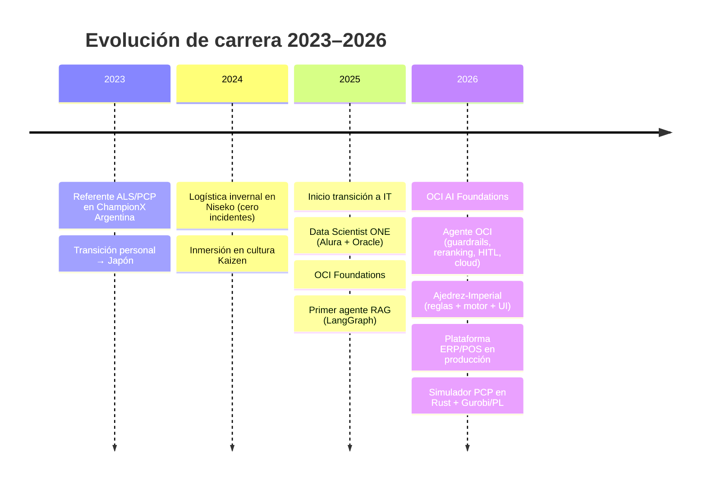

# Gonzalo Costela

[)](https://git.io/typing-svg)

**Experto en Oil & Gas en transición a AI Engineering: construyo agentes, RAG y sistemas de ML en producción.**

## 🚀 Sobre mí

> *"No vengo del mundo tech. Vengo del campo petrolero, donde un error de diseño puede costar un pozo. Eso me enseñó a construir sistemas que funcionan bajo presión."*

**Soy AI Engineer con una base poco común.** En 2015 entré a PCP Oil Tools (adquirida por Dover, luego Apergy y finalmente ChampionX, hoy parte de SLB) como asistente administrativo; en 2020 ya era **Ingeniero de Aplicaciones y Especialista en Sistemas PCP (ALS) en ChampionX**. En 2021 asumí además la **responsabilidad operativa completa de la base de Santa Cruz, con personal a cargo**, sin dejar de lado la ingeniería de aplicaciones. En ese rol lideré la logística de la base y brindé soporte técnico al resto del país, validando diseños con software industrial (PC-Pump/C-FER, Rodstar) y coordinando con expertos de marca (OLT).

**En 2023, una crisis personal me obligó a reinventarme.** Retomé un sueño pendiente: me fui a Japón sin saber el idioma y viví un año allí, con la posibilidad de trabajar en Tokio, Osaka y Niseko. Esa experiencia me enseñó **adaptabilidad y resiliencia reales**, y me sumergió en la cultura de la **mejora continua (Kaizen)** y la obsesión por la calidad. Aprendí que la excelencia no se improvisa: se construye con criterio, escucha y disciplina diaria.

**Hoy aplico todo eso al mundo IT.** En 2025 inicié mi transición formal, completando la formación **Data Scientist de Oracle Next Education (Alura + Oracle)** y certificándome en **OCI Foundations (2025)** y **OCI AI Foundations (2026)**. Hoy construyo **agentes de IA, pipelines RAG y modelos de ML**, con capacidad de llevarlos a **producción en la nube (GCP/OCI)**. Aporto algo que un junior no tiene: **criterio de negocio, experiencia en operaciones críticas y mentalidad de mejora continua aplicada al código**. Busco roles remotos de **AI / Data / ML Engineering** en Argentina (Mendoza, Buenos Aires, Santa Cruz, Neuquén) o México (Guadalajara, CDMX).

- 🔭 **Actualmente:** simulador de bombas PCP en Rust (privado) + programación lineal con Gurobi + agentes.
- 🌱 **Aprendiendo:** optimización matemática aplicada a operaciones y agentes.
- 💬 **Pregúntame sobre:** RAG, LangGraph, XGBoost/CatBoost, GCP, Firebase, Oil & Gas, PCP/ALS.
- 🎯 **Buscando:** roles remotos de **AI Engineering / Data Science / ML Engineering** en Argentina (Mendoza, Buenos Aires, Santa Cruz, Neuquén) o México (Guadalajara, CDMX).

---

## 🛠️ Stack por capas

**Data & ML**  

**Agentes & LLM**  

**Cloud & Infra**  

**Sistemas & Producto**  

**Dominio industrial**  
`PCP / ALS` · `PC-Pump (C-FER)` · `Rodstar` · `VFDs Danfoss` · `Oracle ERP` · `Odoo` · `Lean 5S/Kaizen`

---

## 🌐 Idiomas

| Idioma | Nivel | Validación |
|---|---|---|
| **Español** | Nativo | — |
| **Inglés — nivel actual** | B1–B2 estimado (2026) | Duolingo English Test: **115** |
| **Inglés — respaldo formal** | CEFR A2 (2020) | Anglia Examinations (Credencial N.º 742-1056290) |

> Mi inglés hablado mejoró significativamente tras vivir y trabajar un año en Japón en entornos internacionales (Tokio, Osaka, Niseko).

---

## 🧪 Proyectos destacados

### 🤖 Agente OCI — RAG para Control de Operaciones Industriales
Agente de IA para coordinación operativa y HSE en campos petroleros. Arquitectura *agentic workflow* con **LangGraph + Gemini 3.1 Flash-Lite + FAISS**, triaje inteligente, **RAG con reranking en dos pasos** (Cross-Encoder local), **guardrails HSE** y **Human-in-the-loop**. Demo en Streamlit Cloud.  
**Stack:**        
🔗 [Repo](https://github.com/Haruki-24/Challenge-Alura-Agente-OCI)

### 🧠 Agente de Triaje & RAG para RRHH
Agente que clasifica tickets, resuelve dudas con RAG y escala incidencias. Salida estructurada con Pydantic, aristas condicionales y motor RAG sobre FAISS.  
**Stack:**        
🔗 [Repo](https://github.com/Haruki-24/AI_Agent_RAG_LangGraph)

### ♟️ Ajedrez-Imperial — Sistema de reglas, motor y UI
Variante de ajedrez 10x10 con mecánica shogi. Diseñé el **sistema de reglas** (mecánicas propias para garantizar dinamismo), el **manual de juego**, el **motor con minimax** y una **UI funcional**. MVP entregado en agosto 2026; en pausa para rediseño visual 2.5D isométrico chibi.  
**Stack:**     
🔗 [Repo](https://github.com/Haruki-24/Ajedrez-Imperial)

---

## 📦 Casos de estudio (privados / colaborativos)

### 📊 Krypton — Predicción de Cancelación de Clientes (ML + Cloud)
Proyecto colaborativo (NoCountry). Responsable del **modelado de doble capa (XGBoost + CatBoost)** para predecir probabilidad de cancelación y motivos, optimizando **recall de 70% → 85%**. Diseñé también la **arquitectura en GCP** (Compute Engine, Load Balancers, buckets) con aplicaciones contenerizadas.  
**Stack:**      
📄 Documentación técnica disponible bajo solicitud.

### 🏪 Plataforma ERP/POS Omnicanal — MC8 & Princess Fanny *(en producción)*
Sistema integral en producción (React + TypeScript + Firebase) con storefront multi-marca, POS, mesa de cobranza, WMS, logística, inventario con auditoría, CMS y **RBAC de 6 roles**. Diseñado para operar en **Firebase Spark Plan** (+3,000 SKUs, 50k lecturas/día) mediante **caché en 3 niveles**, **índice de búsqueda compilado (~200 KB)** y transacciones atómicas.  
**Stack:**        
🔒 Código privado (proyecto de empresa). Documentación de arquitectura disponible bajo solicitud.

---

## 🗺️ Evolución reciente

- **Mayo 2026** — Primer agente RAG (LangGraph)
- **Junio 2026** — Agente OCI con guardrails, reranking, HITL y demo cloud
- **Agosto 2026** — Ajedrez-Imperial (reglas + motor + UI + manual)
- **Septiembre 2026** — Plataforma ERP/POS en producción
- **Octubre 2026** — Simulador PCP en Rust (privado) + Gurobi/PL

---

## 📜 Certificaciones

- **Oracle Cloud Infrastructure Certified AI Foundations Associate** (Oracle, 2026)
- **Oracle Cloud Infrastructure Certified Foundations Associate** (Oracle, 2025) 
- **Data Scientist Professional — Oracle Next Education G8** (Alura Latam & Oracle, 2025)
- **Planificación del Mantenimiento** (DINALIA, 2020)
- **Variadores de Frecuencia Danfoss FC 202** (Grupo Equitécnica, 2018)
- **Lubricación Industrial** (Mobil Industrial Lubricants, 2020)
- **Ganador Rally Latinoamericano de Innovación 🏆 — Instancia Nacional** (equipo NASH)

---
## 📊 GitHub Stats

---

## 📫 Contacto

📍 Mendoza, Argentina · Abierto a remoto (AR/MX)

*"La mejora continua no es una metodología, es una forma de vida."*

